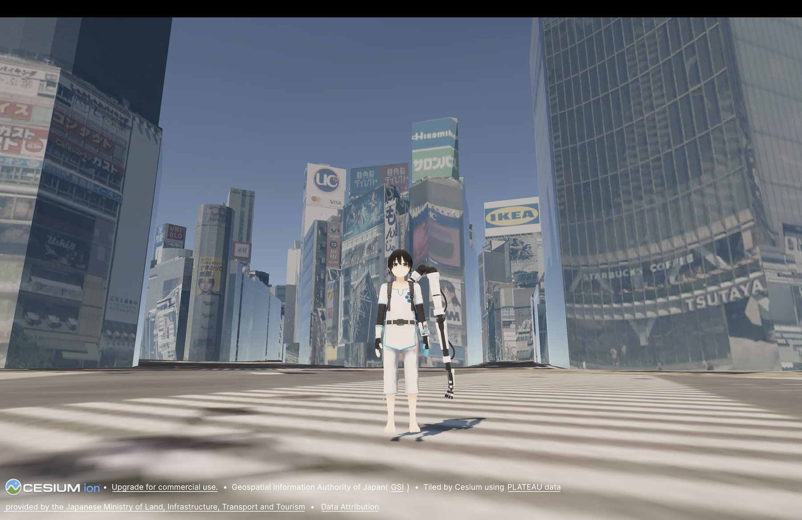

# Cesium × VRM ハッカソン スタートガイド
**実在の街で、自分の VRM アバターを歩かせよう**

> ⏱ 所要時間：60〜90 分　／　🎯 ゴール：渋谷の街並みの中を、自分の VRM アバターが三人称視点で歩き回れる状態



### 動作確認済みバージョン

| ソフトウェア | バージョン |
|---|---|
| Unity | 6.3 LTS（6000.3 系の最新パッチ） |
| Cesium for Unity | 1.25.0 |
| UniVRM | 0.131.2 |


---

## 1. 準備するもの

- [ ] **Unity Hub** と **Unity 6.3 LTS**（Web 書き出しをするなら Web Build Support モジュールも）
- [ ] **git**（ターミナルで `git --version` が表示されれば OK）
- [ ] **Cesium ion アカウント**（無料）… https://ion.cesium.com/
- [ ] **VRM ファイル**（手元になければ VRM コンソーシアム公式サンプル [Seed-san](https://github.com/vrm-c/vrm-specification/tree/master/samples)）
- [ ] **歩行モーション**（Idle / Walk / Run の 3 つ。8 章で入手します）

---

## 2. プロジェクトを作る

1. Unity Hub で **New project** → テンプレート **Universal 3D（URP）** を選ぶ
2. 名前を付けて **Create project**

✅ **チェック**：空のシーンが開いていれば OK

---

## 3. Cesium for Unity を導入する

### 3-1. Scoped Registry を登録

`Edit > Project Settings > Package Manager` の **Scoped Registries** に以下を追加して **Save**。

| 項目 | 値 |
|---|---|
| Name | `Cesium` |
| URL | `https://unity.pkg.cesium.com` |
| Scope(s) | `com.cesium.unity` |

### 3-2. インストール

`Window > Package Management > Package Manager` → 左上のペインで **My Registries** → **Cesium** → **Cesium for Unity** → **Install**

> ⚠️ **警告は無視**：インストール時に `Missing Signature` という警告ダイアログが出る場合がありますが、**Close** してください。

### 3-3. Cesium ion に接続してトークンを作る

#### Unity を Cesium ion に接続

1. メニュー `Cesium > Cesium` でパネルを開き、**Connect to Cesium ion** → ブラウザでログイン・許可(Allow)

#### Cesium ion のウェブサイトでトークンを作成

2. ブラウザで [Cesium ion](https://ion.cesium.com/) を開き、上部の **Access Tokens** タブ → **Create token**
3. 以下のように設定して **Create**

   | 項目 | 値 |
   |---|---|
   | Name | 分かりやすい名前（例：`cesium-vrm-hackathon`） |
   | Scopes | **assets:read** にチェック（初期状態のままで OK） |
   | Resources | **All assets** |

#### Unity で作成したトークンを使う

4. Cesium パネルの **Token** を押す
5. **Use an existing token** を選び、一覧から手順 3 で作成したトークンを選択
6. **Use as Project Default Token** を押す

> ⚠️ **"Create a new token" は使わないでください**：Unity 側の **Create a new token** は正しく動作しないことがあるため、必ずウェブサイトで作成したトークンを **Use an existing token** で選んでください。

<!-- TODO: トラブルシューティング画面のスクリーンショット -->
> ⚠️ **よくあるつまずき**：タイル追加時に「Cesium ion Token Troubleshooting」画面が出て ✕ が並ぶ場合は、トークンが設定されていません。画面の **Select or create a new project default token** を押し、**Use an existing token** でウェブサイトで作成したトークンを選んでください。

> 🔒 **トークンの取り扱い**：トークンは `Assets/CesiumSettings/Resources/CesiumRuntimeSettings.asset` に保存されます。**このファイルを GitHub などで公開しないでください。**

---

## 4. 渋谷の街を表示する

地形と建物には、日本向けの高精度データを使います。

| 用途 | データ | 中身 |
|---|---|---|
| 地形 | **Japan Regional Terrain** | 国土地理院 基盤地図情報の標高データ（1〜10m 解像度） |
| 建物 | **Japan 3D Buildings**（Asset ID `2602291`） | 国交省 PLATEAU の 3D 都市モデル（属性情報付き） |
| 航空写真 | **Bing Maps Aerial**（Asset ID `2`） | 地形に重ねる衛星・航空写真 |


### 4-1. アセットを自分のアカウントに追加

1. ブラウザで [Cesium ion](https://ion.cesium.com/) を開き、**Asset Depot** へ
2. 「**Japan Regional Terrain**」と「**Japan 3D Buildings**」を検索し、それぞれ **Add to my assets**

### 4-2. Unity のシーンに追加

1. Cesium パネルの **+ Add** を押して **Cesium ion Assets** を開く
2. 一覧から **Japan Regional Terrain** を選んで **Add to Level**
3. 同様に **Japan 3D Buildings Data** を **Add to Level**
4. Hierarchy の **Japan Regional Terrain** を選び、 インスペークターで **Add Component > Cesium Ion Raster Overlay** を追加して **Ion Asset ID** を `2` に設定（地形に航空写真を重ねる）

### 4-3. 原点を渋谷に設定

Hierarchy の **CesiumGeoreference** を選び、**Origin (Longitude Latitude Height)** を設定

| 項目 | 値 |
|---|---|
| Latitude | `35.6595` |
| Longitude | `139.7005` |
| Height | `50` |

### 4-4. 当たり判定を確認

Japan Regional Terrain と Japan 3D Building Data のゲームオブジェクトそれぞれで、`Cesium3DTileset` の **Create Physics Meshes** にチェックが入っていることを確認（アバターの当たり判定に必要）

> 💡 **さらに細かくしたい場合**：地形タイルセットの **Maximum Screen Space Error** を既定の `16` から `4`〜`8` に下げると、より詳細なタイルが読み込まれます（その分、読み込みは重くなります）。

> ⚖️ **出典表示**：Japan 3D Buildings を使うアプリには「**3D都市モデルデータ（国土交通省）**」の表示が必要です。地形データについても国土地理院の出典表示を確認してください。

> ⚠️ **【クレジット表示に関する注意】**
>
> 作品、スクリーンショット、動画等を公開する際は、Cesium ionロゴおよびData Attributionを削除・非表示にせず、トリミングや独自UI等によって隠れないようにしてください。
>
> 常時クレジットを表示したい場合は、Tilesetの「Show Credits On Screen」をONにすることで表示できます。
>
> また、Japan 3D Buildingsを経由せずPLATEAUデータを直接利用する場合は、使用するデータの利用条件・出典表示条件をご確認ください。
>
> 作品が国土交通省またはProject PLATEAUの公式制作・公認作品であると誤認されるような表現も避けてください。

> 🗾 **対象地域**：Japan 3D Buildings は PLATEAU が整備された約 210 の自治体が対象です。渋谷以外を使う場合は、その場所が対象か確認してください。

✅ **チェック**：Scene ビューで、航空写真付きの平らな交差点と建物が見えていれば OK
（Playモードで飛び回って確認したい場合は、Cesium パネルから **Dynamic Camera** を追加して Main Camera を無効化。WASD / QE / マウスで移動できます。確認後は **Dynamic Camera を無効化して Main Camera を戻してください**）

---

## 5. VRM アバターを置く

### 5-1. UniVRM をインストール

`Window > Package Management > Package Manager` → 左上 **＋** → **Install package from git URL...** で、**この順番で** 2 つインストール。

```
https://github.com/vrm-c/UniVRM.git?path=/Packages/UniGLTF#v0.131.2
https://github.com/vrm-c/UniVRM.git?path=/Packages/VRM10#v0.131.2
```

### 5-2. VRM を読み込んで配置

1. 使用する `.vrm` ファイルを Project ウィンドウの `Assets/` にドラッグ
2. 生成された Prefab を Hierarchy の **CesiumGeoreference の子** になるようにドラッグ
3. アバターゲームオブジェクトに **Add Component > Cesium Globe Anchor** を付け、**Position (Latitude, Longitude, Height)** を設定

   | 項目 | 値 |
   |---|---|
   | Lat | `35.6595` |
   | Lon | `139.7005` |
   | H | `55`〜`65`（地面より少し上） |

> 💡 Height は「標高」ではなく「楕円体高」です。東京ではおおよそ **標高 ＋ 37m** になります。

✅ **チェック**：Scene ビューで渋谷の地面付近にアバターが立っていれば OK

---

## 6. 地面の上を歩かせる

1. 配布物の `VrmWalker.cs` と `ThirdPersonCamera.cs` を `Assets/Scripts/` に入れる
2. アバターのルートに **Add Component > Character Controller** を追加して設定

   | 項目 | 値 |
   |---|---|
   | Height | `1.6`（アバターの身長に合わせる） |
   | Radius | `0.25` |
   | Center | `0, 0.8, 0`（Height の半分） |
   | Step Offset | `0.3` |
   | Slope Limit | `45` |

3. 同じくアバターに **Vrm Walker** を追加し、**Wait For Tilesets** のサイズを `2` にして以下のゲームオブジェクトをドラッグ
   - `Japan Regional Terrain`
   - `Japan 3D Buildings`

| 操作 | キー |
|---|---|
| 移動 | W / A / S / D（カメラの向き基準） |
| 走る | Shift |
| ジャンプ | Space |

> 💡 VrmWalker はタイルの読み込み完了を待ってから着地します。Play 直後に数秒止まるのは正常です。

---

## 7. 三人称カメラを付ける

1. **Main Camera** に **ThirdPersonCamera** を追加し、**Target** にアバターオブジェクトを指定
2. Main Camera の **Clipping Planes** を Near `0.1` / Far `100000` に変更

| 操作 | 入力 |
|---|---|
| 視点操作を開始 | 画面を左クリック（マウスがロックされる） |
| 視点を回す | マウス |
| 距離を変える | ホイール |
| マウスロック解除 | Esc |

> 💡 マウス感度は Inspector の **Sensitivity** で調整できます。

✅ **チェック**：Play して、渋谷の街をアバターが歩き回れれば OK（この時点ではまだ T ポーズのまま滑るように動きます）

---

## 8. 歩行アニメーションを付ける

### 8-1. モーションを入手

例：**[Mixamo](https://www.mixamo.com/)**（Adobe アカウントで無料）で「Idle」「Walking」「Running」を検索してダウンロード

- Walking / Running は **In Place** にチェック
- Format：**FBX for Unity** ／ Skin：**Without Skin**

> ⚖️ **ライセンス**：Mixamo のモーションは**ファイル単体での再配布ができません**。各自でダウンロードしてください。

### 8-2. Humanoid として読み込む

FBX を `Assets/Animations/` に入れ、それぞれ選択して設定 → **Apply**

| タブ | 設定 |
|---|---|
| Rig | Animation Type：**Humanoid** ／ Avatar Definition：**Create From This Model** |
| Animation | **Loop Time** と **Loop Pose** にチェック ／ Root Transform の Rotation・Position (Y)・Position (XZ) すべて **Bake Into Pose** にチェック |

### 8-3. Animator Controller を作る

1. `Assets/Animations` で右クリック → **Create > Animation > Animator Controller**（名前：`VrmLocomotion`）
2. ダブルクリックで開き、**Parameters** タブで **+** から **Float 型の `Speed`** を追加
3. 空いている所を右クリック → **Create State > From New Blend Tree**
4. **Blend Tree の箱をダブルクリックして中に入り、中のノードをクリック**

   > ⚠️ **よくあるつまずき**：外側の箱を選んだままだと、Inspector に Blend Type などの設定項目が出てきません。上部のパンくずが `Base Layer > Blend Tree` になっていることを確認してください。

5. Inspector で設定
   - Blend Type：**1D**
   - Parameter：**Speed**（自動で作られる `Blend` パラメータは削除して OK）
   - **＋ > Add Motion Field** を 3 回押して **Idle**, **Walking**, **Running** クリップを割り当て
   - **Automate Thresholds** のチェックを外し、Threshold を入力

   | Motion | Threshold |
   |---|---|
   | Idle | `0` |
   | Walking | `2`（VrmWalker の Walk Speed と同じ） |
   | Running | `5`（VrmWalker の Run Speed と同じ） |

### 8-4. アバターに設定

アバターのルートの **Animator** で
- **Controller** に `VrmLocomotion` を指定
- **Apply Root Motion** のチェックを外す

✅ **チェック**：Play して、止まる・歩く・走るでモーションが切り替われば **完成です 🎉**

---

## 9. 困ったときは

| 症状 | 原因と対処 |
|---|---|
| タイル追加時にトークンエラーが出る | トークンが未設定。3-3 の手順でウェブサイトでトークンを作成し、Unity の **Use an existing token** で選ぶ |
| 一覧に作成したトークンが出てこない | Unity が Cesium ion に接続されていないか、別のアカウントで接続している。3-3 の手順 1 をやり直す |
| Play すると地面の中から始まる | VrmWalker の **Wait For Tilesets** が未設定。地形と建物の 2 つを登録する。Globe Anchor の Height が低すぎないかも確認 |
| 地面が波打つ・粗く見える | 地形の詳細度が足りない。Japan Regional Terrain の **Maximum Screen Space Error** を下げる（4-4 参照） |
| 地形に航空写真が表示されない（灰色） | Japan Regional Terrain に **Cesium Ion Raster Overlay**（Asset ID `2`）が付いていない |
| アバターが地面をすり抜けて落ちる | タイルセットの **Create Physics Meshes** がオフになっていないか確認 |
| 着地せずに浮いたまま | 真下に地面が見つかっていない。Height を地面に近づける／VrmWalker の Ground Probe Up を大きくする |
| ビルの屋上に着地する | Globe Anchor の Height を地面の高さに近づける |
| 足が地面に埋まる・浮く | Character Controller の Center / Height を微調整。Blend Tree の状態で **Foot IK** をオンにする |
| Blend Tree の設定項目が見つからない | Blend Tree の中に入って中央のノードを選択する（8-3 の注意を参照） |
| git URL でインストールできない | git が未インストール。`git --version` で確認 |

---

## 10. 次のステップ

ここからはあなたのアイデア次第です。発展させるときに役立つトピック：

- **遠くまで移動したい** → `CesiumOriginShift` で原点をアバターに追従させる（座標精度のズレ・揺れ対策）。原点移動やワープ後は VRM の SpringBone（髪・服の揺れ）をリセットすると安定します
- **好きな場所に行きたい** → Georeference の原点と Globe Anchor の緯度経度を変えるだけ（建物が表示されるのは PLATEAU の対象地域のみ）
- **よりリアルな街並み** → Google Photorealistic 3D Tiles（建物ごとの区別はできない点に注意）
- **建物を区別したい** → Raycast で当たったタイルからメタデータ（feature ID）を取得（Japan 3D Buildings は PLATEAU の属性情報を持っています）
- **ブラウザで公開したい** → Cesium for Unity の Web 書き出し（Unity 6 以降が必要）

### 参考リンク
- [Cesium for Unity 公式ドキュメント](https://cesium.com/learn/unity/)
- [Cesium for Unity クイックスタート](https://cesium.com/learn/unity/unity-quickstart/)
- [Japan 3D Buildings & Terrain（Cesium）](https://cesium.com/platform/cesium-ion/content/japan-3d-buildings/)
- [Project PLATEAU（国土交通省）](https://www.mlit.go.jp/plateau/)
- [UniVRM（GitHub）](https://github.com/vrm-c/UniVRM)
- [VRM 公式サイト](https://vrm.dev/)
